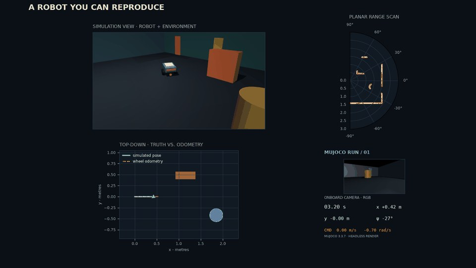

# Physical AI Learner Lab

 

This repository is a small robotics lab built around a two-wheel robot in MuJoCo. It is meant to be run and changed: inspect the model, drive the robot, view its simulated camera and range scan, and compare wheel odometry with the simulator's true pose. An optional ROS 2 Humble container sends commands and receives odometry and scan messages.

[Open the tutorial](https://supashbhat.github.io/physical-ai-learner-lab/) · [Read the case study](https://supashbhat.github.io/physical-ai-learner-lab/case-study/) · [Browse the source](https://github.com/supashbhat/physical-ai-learner-lab)

The still image and the [drive demo video](docs/assets/demo_drive.mp4) come from running the included simulation script. The robot, room, camera frames, range scan, and odometry plot are simulated; there is no physical robot and no trained AI model in this project. The kinematics diagram is a small, hand-authored SVG. The depth output has a documented graphics-backend precision limitation, so it is illustrative rather than sensor-grade data.

## Run it on macOS

Requirements: macOS 14 or later, Python 3.12 or 3.13, and about 2 GB of free disk space. Docker Desktop is only needed for the optional ROS 2 module.

~~~bash
git clone https://github.com/supashbhat/physical-ai-learner-lab.git
cd physical-ai-learner-lab
./scripts/setup_macos.sh
./scripts/run_lab.sh
~~~

For a run without a graphics window:

~~~bash
./scripts/run_lab.sh --headless
~~~

## What is in the lab

- **Model and control:** a MuJoCo robot with actuated wheels, contact surfaces, obstacles, and bounded differential-drive control.
- **Sensors and odometry:** an RGB/depth camera, a simulated 181-ray planar scan, and wheel-integrated odometry kept separate from simulator truth.
- **ROS 2:** an optional authenticated bridge to a ROS 2 Humble node in Docker.
- **Learning material:** a quickstart, short explanations, exercises, and troubleshooting notes.

## Checks

The local suite covers the controller, model, sensing, odometry, and bridge protocol. The GitHub Actions workflow runs the suite and strict tutorial build on Apple Silicon and Intel macOS; a separate job checks the ROS 2 container topics.

To run the local checks:

~~~bash
source .venv/bin/activate
pytest -q
ruff check src tests docker
ruff format --check src tests docker
mkdocs build --strict
~~~

I used AI assistance for some scaffolding and early drafts. I ran the simulator, checked the outputs, and corrected mistakes the tests and longer runs exposed; the repository keeps the remaining limitations visible.

## Repository map

~~~text
robot/                  MuJoCo robot and room model
src/physical_ai_lab/    Controller, simulation, sensors, odometry, bridge
tests/                  Model, control, sensing, odometry, protocol checks
docker/                 ROS 2 node and container checks
docs/                   Tutorial and simulation media
scripts/                macOS setup and run scripts
~~~
