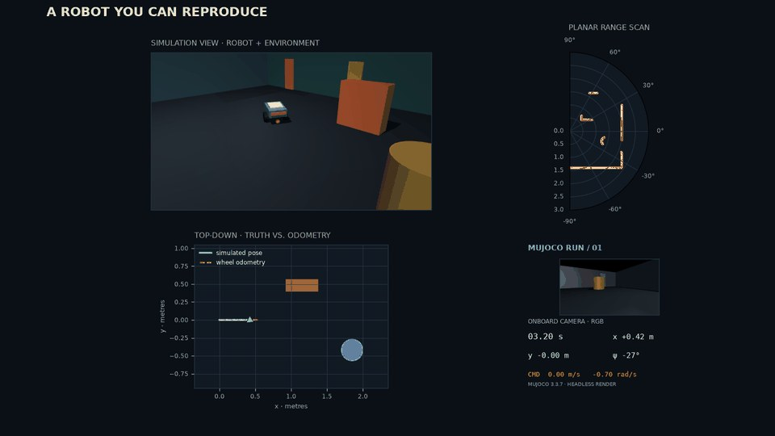

# Physical AI Learner Lab: project case study

I built this lab to make a small robotics stack inspectable from the robot model through motion, sensing, and odometry. The central question was simple: can someone change one part of the simulation, run it locally, and see what that change did?

## What is in the lab

The robot is a differential-drive model in MuJoCo. Its wheel joints drive the chassis through a bounded velocity controller. A scripted route provides a repeatable run, while the dashboard shows the simulated camera, a planar ray-cast range scan, wheel-integrated odometry, and simulator pose together.

An optional ROS 2 bridge accepts bounded velocity commands and publishes odometry and scan messages. The simulator remains usable without ROS 2; the bridge is an additional path for connecting the model to a ROS workflow.

{ .case-study-image }

The clips and images on the [lab overview](index.md) come from the repository’s deterministic simulation scripts. They show simulator output, not footage from a physical robot. The RGB and depth archive is synthetic and is not used to train a model.

## Checks that changed the implementation

- The first wheel-direction check exposed a sign mismatch between the joint axis and the controller convention. I corrected the model/control mapping and retained a route-distance check.
- A strict `sim.time >= 5.0` assertion failed at a value just below five because of accumulated floating-point error. The duration check now uses a small tolerance.
- A chassis pitch issue was not visible in a short startup check. I added a longer tilt check and adjusted the front skid geometry.
- Wheel odometry is integrated separately from MuJoCo’s body pose so the comparison remains meaningful; the ground-truth pose is not fed into the odometry estimate.

## Reproducing it

The core lab targets macOS with a pinned Python environment. The repository includes setup and run scripts, automated tests, and a strict MkDocs build. The ROS 2 path uses a container and has its own integration check. Hardware and learner feedback have not yet been used to validate this simulator exercise.

```bash
git clone https://github.com/supashbhat/physical-ai-learner-lab.git
cd physical-ai-learner-lab
./scripts/setup_macos.sh
./scripts/run_lab.sh
```

See the [quickstart](quickstart.md), [reproducibility notes](reproducibility.md), and [troubleshooting guide](troubleshooting.md) for setup details and known limits.

## Current scope

This is a learning lab built around MuJoCo simulation. The camera and range scan are rendered or ray-cast in the simulated scene; the data is synthetic. The ROS 2 adapter connects software components but does not demonstrate hardware deployment. Future ideas such as RViz visualization, sensor-noise studies, and USD export are not implemented yet.

[Open the tutorial](index.md) · [Browse the source](https://github.com/supashbhat/physical-ai-learner-lab)
