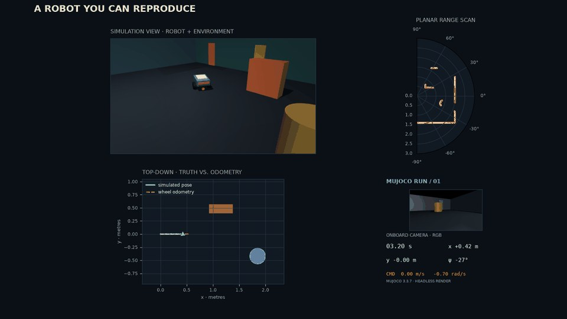

<section class="lab-hero">
  <div class="lab-kicker">SUPASH BHAT · ROBOTICS</div>
  <h1>Build a robot you can explain and reproduce.</h1>
  <p>A small robotics stack, kept inspectable: change the model, drive it in MuJoCo, view its simulated camera and range scan, then compare wheel odometry with simulator truth. An optional ROS 2 bridge carries commands and sensor messages between the simulator and a container.</p>
  <div class="lab-actions">
    <a class="lab-button" href="quickstart/">Start the lab <span aria-hidden="true">→</span></a>
    <a class="lab-button secondary" href="https://github.com/supashbhat/physical-ai-learner-lab">Browse the source</a>
  </div>
</section>

{ .lab-demo }

## Learn by building

<div class="lab-grid">
  <div class="lab-card"><span class="lab-stat">01 / MODEL</span><b>Give the robot a body</b><span>Read the MuJoCo XML: chassis, wheel joints, actuators, contact surfaces, and a small obstacle course.</span></div>
  <div class="lab-card"><span class="lab-stat">02 / MOTION</span><b>Connect commands to motion</b><span>Derive differential-drive wheel speeds, follow a velocity command, and compare the predicted and simulated path.</span></div>
  <div class="lab-card"><span class="lab-stat">03 / SENSE</span><b>Make state observable</b><span>Render a camera view, cast a planar range scan, and track wheel-integrated odometry alongside simulator truth.</span></div>
</div>

## Three views of the same run

<div class="lab-video-grid">
  <div class="lab-video-card">
    <h3>01 · Drive and camera</h3>
    <video class="lab-video" controls preload="metadata" poster="assets/synthetic_frames.png" aria-label="MuJoCo robot driving with camera, range scan, and odometry">
      <source src="assets/demo_drive.mp4" type="video/mp4">
      <a href="assets/demo_drive.mp4">Open the drive demo</a>.
    </video>
    <p class="lab-caption">A deterministic eight-second run with RGB camera, simulated scan, and path estimate.</p>
  </div>
  <div class="lab-video-card">
    <h3>02 · Range scan</h3>
    <video class="lab-video" controls preload="metadata" poster="assets/synthetic_frames.png" aria-label="Planar simulated range scan">
      <source src="assets/demo_lidar.mp4" type="video/mp4">
      <a href="assets/demo_lidar.mp4">Open the range-scan video</a>.
    </video>
    <p class="lab-caption">181 rays across a 180° field of view.</p>
  </div>
  <div class="lab-video-card">
    <h3>03 · Wheel odometry</h3>
    <video class="lab-video" controls preload="metadata" poster="assets/synthetic_frames.png" aria-label="Wheel odometry compared with simulator ground truth">
      <source src="assets/demo_odom.mp4" type="video/mp4">
      <a href="assets/demo_odom.mp4">Open the odometry video</a>.
    </video>
    <p class="lab-caption">Wheel-integrated estimate compared with simulated pose.</p>
  </div>
</div>

## Start with a clean run

```bash
git clone https://github.com/supashbhat/physical-ai-learner-lab.git
cd physical-ai-learner-lab
./scripts/setup_macos.sh
./scripts/run_lab.sh
```

The first checked setup is Apple Silicon macOS with Python 3.13. MuJoCo 3.3.7 publishes matching Python wheels for Intel Macs; the configured CI matrix targets both macOS architectures.

## What makes this a useful lab?

- **Real model:** wheels, joints, contact, motor actuation, a camera, and ray-based sensing run in MuJoCo.
- **Separate estimates:** wheel odometry is integrated from joint motion, then compared against the simulator's body pose.
- **Visible evidence:** the demo shows the camera, scan, and trajectory from the same deterministic run.
- **ROS 2 path:** bounded velocity commands enter over a token-authenticated TCP connection; standard odometry and scan messages return from the container.
- **Honest reproducibility:** versions, test commands, and known limits are written down; features that need Docker are separately tested.

## Project links

- [Quickstart](quickstart.md)
- [Exercises and answer key](exercises.md)
- [Connect ROS 2](ros2-bridge.md)
- [Synthetic RGB and depth](synthetic-data.md)
- [Reproducibility notes](reproducibility.md)
- [Source repository](https://github.com/supashbhat/physical-ai-learner-lab)
- [Supash Bhat's portfolio](https://supashbhat.github.io/)
