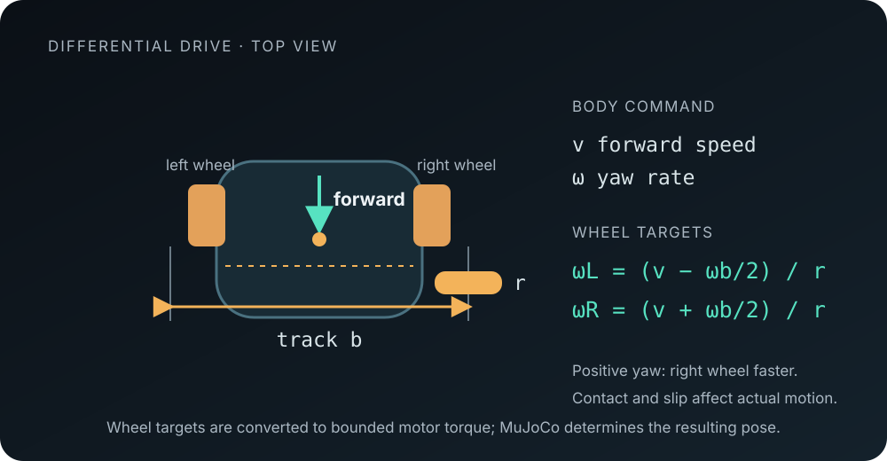

# Motion and control



The controller accepts body-frame linear speed `v` in metres per second and yaw rate `ω` in radians per second. For wheel radius `r` and wheel track `b`, the ideal wheel speeds are

The wheel-speed targets follow the differential-drive inverse-kinematics equations:

<p><code>ωL = (v − ωb/2) / r</code> &nbsp; and &nbsp; <code>ωR = (v + ωb/2) / r</code></p>

The model's wheel axes are oriented so positive joint speed rolls forward. A proportional wheel-speed controller turns the target into bounded motor torque:

<p><code>τi = clip(kp (ωi* − q̇i), −τmax, τmax)</code></p>

## Run a straight command

```bash
./scripts/run_lab.sh --headless --seconds 5 --speed 0.28
```

The checked-in default travels approximately one metre. The output reports the simulator's measured body pose; the controller does not force the body position to match the command.

## Turn in place

```bash
./scripts/run_lab.sh --headless --seconds 2 --speed 0 --turn-rate 0.8
```

A positive yaw command requests a faster right wheel than left wheel. Compare the wheel target test in `tests/test_control.py` with the plotted trajectory in the demo.

## What changes the result?

- Wheel radius changes the speed produced by a given angular rate.
- Track width changes how much angular speed difference is needed to turn.
- Torque saturation limits acceleration.
- Contact and slip can make the simulated path differ from ideal kinematics.

The project reports that difference rather than silently setting the simulator pose to the ideal path.
